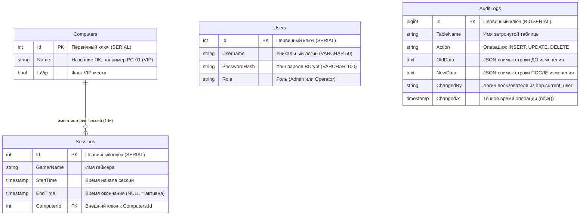

# ОТЧЕТ ПО ЛАБОРАТОРНЫМ РАБОТАМ №1–5
## Дисциплина: «Разработка классических и кроссплатформенных приложений на платформе .NET»
### Тема: «Создание десктопной системы управления компьютерным клубом "CyberArena" с использованием C#, Entity Framework Core, PostgreSQL (Supabase) и механизмов аудита»

---

## 📌 Оглавление
1. [Введение и цели работы](#1-введение-и-цели-работы)
2. [Используемый стек технологий](#2-используемый-стек-технологий)
3. [Архитектура данных и ER-диаграмма](#3-архитектура-данных-и-er-диаграмма)
4. [Структура репозитория](#4-структура-репозитория)
5. [Ход выполнения работы](#5-ход-выполнения-работы)
   - [Лабораторная работа №1: Базовое приложение и связь с облаком](#лабораторная-работа-1-базовое-приложение-и-связь-с-облаком)
   - [Лабораторная работа №2: Журнал операций и связывание данных](#лабораторная-работа-2-журнал-операций-и-связывание-данных)
   - [Лабораторная работа №3: Аутентификация, хэширование BCrypt и ролевой доступ](#лабораторная-работа-3-аутентификация-хэширование-bcrypt-и-ролевой-доступ)
   - [Лабораторная работа №4: Логирование аудита на уровне СУБД PostgreSQL](#лабораторная-работа-4-логирование-аудита-на-уровне-субд-postgresql)
   - [Лабораторная работа №5: Аналитика, агрегация и экспорт в CSV](#лабораторная-работа-5-аналитика-агрегация-и-экспорт-в-csv)
6. [Ключевые листинги кода](#6-ключевые-листинги-кода)
7. [Инструкция по развертыванию и запуску](#7-инструкция-по-развертыванию-и-запуску)
8. [Контрольные вопросы и ответы к защите](#8-контрольные-вопросы-и-ответы-к-защите)
9. [Заключение](#9-заключение)

---

## 1. Введение и цели работы

**Цель комплексного проекта**: Освоение полного цикла разработки коммерческого настольного приложения с использованием языка C#, компонентного интерфейса (WPF / Avalonia UI), объектно-реляционного отображения (ORM EF Core) и облачной реляционной базы данных PostgreSQL (Supabase).

**Основные задачи**:
1. Разработать реляционную модель компьютерного клуба (компьютеры, игровые сессии, пользователи, журнал аудита).
2. Настроить надежное асинхронное взаимодействие с облачной СУБД без блокировки пользовательского интерфейса.
3. Реализовать двухпанельный интерфейс администратора с фильтрацией на лету и валидацией бизнес-правил.
4. Внедрить стойкую подсистему аутентификации на базе алгоритма BCrypt с разделением прав доступа (Администратор / Оператор).
5. Разработать защищенный от фальсификации механизм аудита на стороне PostgreSQL с помощью триггеров и сериализации строк в JSON.
6. Создать аналитический сервис формирования отчетов за произвольные периоды и экспорт в формат CSV (с поддержкой кириллицы в MS Excel через UTF-8 BOM).
7. Обеспечить кроссплатформенность: возможность запуска как на Windows (WPF), так и на Linux (Avalonia UI в среде VS Code).

---

## 2. Используемый стек технологий

| Компонент | Технология | Назначение |
|---|---|---|
| **Язык разработки** | C# 10 / 12 (.NET 6 / .NET 8) | Ядро логики и алгоритмов |
| **Десктопный UI (Windows)** | Windows Presentation Foundation (WPF) | Графический интерфейс под Windows |
| **Десктопный UI (Linux/Кроссплатформа)** | Avalonia UI 11 | Кроссплатформенный интерфейс с поддержкой XAML |
| **ORM** | Entity Framework Core 6.x / 8.x | Связывание C#-моделей с таблицами PostgreSQL |
| **Провайдер БД** | Npgsql.EntityFrameworkCore.PostgreSQL | Высокопроизводительный драйвер PostgreSQL |
| **Облачная СУБД** | Supabase (PostgreSQL 15+) | Хранение данных, триггеры аудита, пулинг соединений |
| **Криптография** | BCrypt.Net-Next | Безопасное медленное хэширование паролей с солью |
| **Среда разработки** | Visual Studio 2022 / VS Code | Написание кода, сборка, отладка |

---

## 3. Архитектура данных и ER-диаграмма

В базе данных реализовано 4 сущности, нормализованные в третью нормальную форму (3NF):



---

## 4. Структура репозитория

Каждая лабораторная работа оформлена как независимый законченный проект, готовый к защите:

```text
labi/
├── CyberClub.sln                       # Единое решение Visual Studio 2022
├── .vscode/                            # Настройки запуска F5 и сборки в VS Code
│   ├── launch.json
│   └── tasks.json
├── CyberClub_Avalonia/                 # Полнофункциональная кроссплатформенная версия (Linux/macOS/Windows)
│   ├── CyberClubApp.csproj
│   ├── AppDbContext.cs                 # Подключение к пулеру Supabase
│   ├── Models.cs                       # Сущности Computer и Session
│   ├── User.cs                         # Сущность User
│   ├── AuditLog.cs                     # Сущность AuditLog
│   ├── ReportModels.cs                 # DTO-модели для аналитики
│   ├── ReportService.cs                # Сервис бизнес-логики отчётов
│   ├── PasswordHelper.cs               # Хэширование и верификация BCrypt
│   ├── Converters.cs                   # IValueConverter статусов
│   ├── LoginWindow.axaml / .cs         # Окно авторизации
│   ├── MainWindow.axaml / .cs          # Двухпанельная рабочая панель
│   ├── AuditWindow.axaml / .cs         # Окно журнала аудита
│   └── ReportsWindow.axaml / .cs       # Окно отчетов и экспорт в CSV
├── Lab1_CyberClubBasics/               # Лабораторная работа №1 (WPF)
├── Lab2_OperationsJournal/             # Лабораторная работа №2 (WPF)
├── Lab3_AuthAndRoles/                  # Лабораторная работа №3 (WPF)
├── Lab4_AuditLogging/                  # Лабораторная работа №4 (WPF)
│   └── database_triggers.sql           # SQL-триггеры аудита для Supabase
└── Lab5_ReportsAndExport/              # Лабораторная работа №5 (WPF)
    └── database_setup.sql              # Полный скрипт развертывания БД с нуля
```

---

## 5. Ход выполнения работы

### Лабораторная работа №1: Базовое приложение и связь с облаком
* **Что сделано**:
  1. Создан проект WPF (.NET 8) и подключены NuGet-пакеты `Npgsql.EntityFrameworkCore.PostgreSQL` и `Microsoft.EntityFrameworkCore.Design`.
  2. Описаны C#-модели `Computer` (компьютер клуба) и `Session` (сессия геймера) со связью 1-ко-многим через навигационные свойства.
  3. Создан класс `AppDbContext` с настройкой `modelBuilder.Entity<Computer>().HasMany(...).WithOne(...).HasForeignKey(...)`.
  4. Разработан интерфейс окна: заголовок, кнопки действий и таблица `DataGrid` с явным определением столбцов и привязкой данных (`Binding`).
  5. Реализована асинхронная загрузка через `ToListAsync()` с флагами `.AsNoTracking()` (для исключения накладных расходов отслеживания) и `.Include(c => c.Sessions)` (жадная загрузка связанных сущностей).
  6. Реализовано добавление нового ПК в базу через `db.Computers.Add(...)` и `await db.SaveChangesAsync()`.
* **Результат**: Окно отображает список компьютеров из облачной БД, добавленные ПК мгновенно сохраняются в PostgreSQL.

---

### Лабораторная работа №2: Журнал операций и связывание данных
* **Что сделано**:
  1. Модель `Session` расширена полем `EndTime?` (nullable timestamp). Если поле равно `null` — сессия считается текущей/активной.
  2. Добавлены вычисляемые свойства с атрибутом `[NotMapped]`:
     - `Session.IsActive => EndTime == null`
     - `Session.Duration => (EndTime ?? DateTime.UtcNow) - StartTime`
     - `Computer.IsOccupied => Sessions.Any(s => s.EndTime == null)`
  3. Спроектирован двухпанельный интерфейс с `GridSplitter`:
     - **Слева**: таблица компьютеров с цветным статусом («Занят» / «Свободен») через созданный класс `BoolToStatusConverter : IValueConverter`.
     - **Справа**: таблица сессий выбранного ПК, сортированная по убыванию времени начала.
     - **Сверху**: панель живой фильтрации (поиск по подстроке в `TextBox`, чекбоксы «Только свободные» и «Только VIP»). Фильтрация выполняется в памяти по кэшированной коллекции `_allComputers`, предотвращая лишние запросы к сети.
  4. Реализована кнопка **«Посадить за выбранный ПК»**: проверяет, не занят ли компьютер (`pc.IsOccupied`) и заполнено ли имя игрока.
  5. Реализована кнопка **«Закрыть сессию»**: находит актуальную отслеживаемую запись через `await db.Sessions.FindAsync(s.Id)`, выставляет `EndTime = DateTime.UtcNow` и сохраняет изменения. Это решает классическую проблему конфликта трекинга при использовании `AsNoTracking`.
* **Результат**: Полноценный журнал операций «справочник-документ» с защитой от двойной посадки за один ПК и сохранением фокуса после обновления.

---

### Лабораторная работа №3: Аутентификация, хэширование BCrypt и ролевой доступ
* **Что сделано**:
  1. Создана модель `User` (`Id`, `Username`, `PasswordHash`, `Role`).
  2. Интегрирована библиотека `BCrypt.Net-Next`. Создан класс `PasswordHelper`:
     - Метод `HashPassword`: генерация соли и хэширование с фактором трудоемкости `WorkFactor = 12` (занимает ~150 мс, что делает аппаратный перебор на GPU бессмысленным).
     - Метод `VerifyPassword`: проверка пароля с перехватом `SaltParseException`.
  3. Разработано окно входа `LoginWindow` с элементом `PasswordBox` и защитой от перебора (одинаковое сообщение «Неверный логин или пароль» независимо от того, отсутствует ли логин или неверен пароль).
  4. Настроен жизненный цикл приложения в `App.xaml.cs`:
     - Установлен `ShutdownMode = ShutdownMode.OnExplicitShutdown`, чтобы закрытие окна авторизации не приводило к завершению процесса приложения.
     - Окно авторизации открывается через модальный диалог `ShowDialog()`. При успехе объект пользователя передается в `MainWindow`, а режим переключается на `OnMainWindowClose`.
  5. Реализована ролевая политика:
     - **Admin**: доступны все операции (посадка, завершение, аудит, отчеты).
     - **Operator**: кнопки «Посадить» и «Закрыть сессию» блокируются (`IsEnabled = false`), а также защищены программной проверкой роли на уровне C#.
* **Результат**: Безопасный экран входа, стойкое хранение хэшей в БД и разграничение прав доступа.

---

### Лабораторная работа №4: Логирование аудита на уровне СУБД PostgreSQL
* **Что сделано**:
  1. Спроектирована таблица `AuditLogs` (`Id BIGSERIAL`, `TableName`, `Action`, `OldData`, `NewData`, `ChangedBy`, `ChangedAt`).
  2. Вместо ненадежного логирования на стороне клиента написан триггерный механизм прямо в PostgreSQL (PL/pgSQL):
     - Функция `process_audit()` срабатывает `AFTER INSERT OR UPDATE OR DELETE` для таблиц `"Computers"` и `"Sessions"`.
     - Снимки строк автоматически упаковываются в JSON с помощью функции `to_jsonb(OLD)` и `to_jsonb(NEW)`.
     - Логин автора операции считывается из переменной сессии: `current_setting('app.current_user', true)`.
  3. В приложении метод `SetCurrentUser` в `AppDbContext` перед каждым запросом отправляет в базу: `SET app.current_user = 'login'`.
  4. Реализован триггер защиты от подделки `audit_immutable`: блокирует любые `UPDATE` и `DELETE` в таблице `AuditLogs`, вызывая исключение `RAISE EXCEPTION`.
  5. Создано окно `AuditWindow` с фильтрами по имени сотрудника, имени таблицы и отображением последних 200 записей.
* **Результат**: Неуязвимый «чёрный ящик» аудита: любое действие любого сотрудника навсегда сохраняется в БД.

---

### Лабораторная работа №5: Аналитика, агрегация и экспорт в CSV
* **Что сделано**:
  1. Спроектированы модели DTO (Data Transfer Objects), существующие только в оперативной памяти: `ReportSummary`, `PcUsageRow`, `DailyRow`.
  2. Реализован независимый сервис бизнес-логики `ReportService`:
     - Метод `GetSummaryAsync`: фильтрует только закрытые сессии за выбранный период (`EndTime != null`), вычисляет сумму часов, среднюю продолжительность сессии (с защитой от деления на 0 при пустой выборке), вычисляет самого активного игрока через `GroupBy(s => s.GamerName)`.
     - Метод `GetTopPcsAsync`: группирует данные по ПК, подсчитывает число сессий и суммарные часы.
     - Метод `GetDailyAsync`: строит динамику использования клуба по дням.
  3. Разработано окно `ReportsWindow` с выбором периодов («Сегодня», «Неделя», «Месяц»), карточкой сводки и двумя таблицами статистики.
  4. Реализован **экспорт в CSV**:
     - Разделитель полей — точка с запятой (`;`), что соответствует региональным стандартам Excel в РФ.
     - Файл сохраняется с сигнатурой **UTF-8 with BOM** (`new UTF8Encoding(true)`). Это гарантирует, что Excel откроет русский текст корректно без искажения кодировки («кракозябр»).
* **Результат**: Наглядный аналитический дашборд с генерацией готовых бухгалтерских отчетов в CSV/Excel.

---

## 6. Ключевые листинги кода

### 1. Сервис аналитики отчетов (`ReportService.cs`)
```csharp
public async Task<ReportSummary> GetSummaryAsync(DateTime from, DateTime to)
{
    using var db = new AppDbContext();

    // Учитываем только закрытые сессии в выбранном полуинтервале [from, to)
    var sessions = await db.Sessions
        .AsNoTracking()
        .Include(s => s.Computer)
        .Where(s => s.StartTime >= from && s.StartTime < to && s.EndTime != null)
        .ToListAsync();

    if (sessions.Count == 0)
        return new ReportSummary();

    var totalMinutes = sessions.Sum(s => (s.EndTime!.Value - s.StartTime).TotalMinutes);

    var topGamer = sessions
        .GroupBy(s => s.GamerName)
        .Select(g => new
        {
            Name = g.Key,
            Count = g.Count(),
            Minutes = g.Sum(s => (s.EndTime!.Value - s.StartTime).TotalMinutes)
        })
        .OrderByDescending(x => x.Count)
        .ThenByDescending(x => x.Minutes)
        .First();

    return new ReportSummary
    {
        TotalSessions = sessions.Count,
        TotalHours = Math.Round(totalMinutes / 60.0, 1),
        AverageMinutes = Math.Round(totalMinutes / sessions.Count, 0),
        TopGamerName = topGamer.Name,
        TopGamerSessions = topGamer.Count,
        TopGamerHours = Math.Round(topGamer.Minutes / 60.0, 1)
    };
}
```

### 2. Триггерная функция аудита PostgreSQL (`database_setup.sql`)
```sql
CREATE OR REPLACE FUNCTION process_audit()
RETURNS TRIGGER AS $$
DECLARE
    current_user_login TEXT;
BEGIN
    -- Читаем сессионную переменную, переданную из C#
    current_user_login := current_setting('app.current_user', true);

    IF (TG_OP = 'DELETE') THEN
        INSERT INTO "AuditLogs"("TableName", "Action", "OldData", "NewData", "ChangedBy", "ChangedAt")
        VALUES (TG_TABLE_NAME, 'DELETE', to_jsonb(OLD)::text, NULL, current_user_login, now());
        RETURN OLD;
    ELSIF (TG_OP = 'UPDATE') THEN
        INSERT INTO "AuditLogs"("TableName", "Action", "OldData", "NewData", "ChangedBy", "ChangedAt")
        VALUES (TG_TABLE_NAME, 'UPDATE', to_jsonb(OLD)::text, to_jsonb(NEW)::text, current_user_login, now());
        RETURN NEW;
    ELSIF (TG_OP = 'INSERT') THEN
        INSERT INTO "AuditLogs"("TableName", "Action", "OldData", "NewData", "ChangedBy", "ChangedAt")
        VALUES (TG_TABLE_NAME, 'INSERT', NULL, to_jsonb(NEW)::text, current_user_login, now());
        RETURN NEW;
    END IF;
    RETURN NULL;
END;
$$ LANGUAGE plpgsql;

-- Защита от модификации и удаления журнала аудита:
CREATE OR REPLACE FUNCTION prevent_audit_modification()
RETURNS TRIGGER AS $$
BEGIN
    RAISE EXCEPTION 'Audit logs cannot be modified or deleted';
END;
$$ LANGUAGE plpgsql;

CREATE TRIGGER audit_immutable
BEFORE UPDATE OR DELETE ON "AuditLogs"
FOR EACH ROW EXECUTE FUNCTION prevent_audit_modification();
```

### 3. Хэширование и верификация паролей (`PasswordHelper.cs`)
```csharp
public static class PasswordHelper
{
    private const int WorkFactor = 12; // 2^12 итераций (~150 мс на проверку)

    public static string HashPassword(string password)
        => BCrypt.Net.BCrypt.HashPassword(password, workFactor: WorkFactor);

    public static bool VerifyPassword(string password, string storedHash)
    {
        try
        {
            return BCrypt.Net.BCrypt.Verify(password, storedHash);
        }
        catch (BCrypt.Net.SaltParseException)
        {
            return false;
        }
    }
}
```

---

## 7. Инструкция по развертыванию и запуску

### Запуск на Linux в VS Code (Avalonia UI):
```bash
# 1. Сборка проекта
dotnet build CyberClub_Avalonia/CyberClubApp.csproj

# 2. Запуск приложения
dotnet run --project CyberClub_Avalonia/CyberClubApp.csproj
```
Или нажмите клавишу **F5** в VS Code.

### Запуск на Windows в Visual Studio 2022 (WPF):
1. Откройте файл `CyberClub.sln`.
2. В Solution Explorer кликните правой кнопкой мыши по нужному проекту (например, `Lab5_ReportsAndExport`) -> **«Назначить автозагружаемым проектом»**.
3. Нажмите **F5**.

### Учетные данные для проверки:
- **Администратор** (полный доступ): логин `admin`, пароль `admin123`
- **Оператор** (режим чтения): логин `operator`, пароль `operator123`

---

## 8. Контрольные вопросы и ответы к защите

1. **Почему сущности `Computer` и `Session` разделены на две таблицы?**  
   *Ответ*: Это классическая связь «один-ко-многим». У одного ПК со временем накапливаются сотни игровых сессий. Объединение их в одну таблицу привело бы к дублированию названия ПК в каждой строке и нарушению нормальной формы (аномалии обновления и удаления).

2. **Зачем нужен вызов `.AsNoTracking()`?**  
   *Ответ*: По умолчанию EF Core кэширует сущности в `ChangeTracker`. Для операций чтения (заполнение таблиц) это тратит лишнюю оперативную память и время процессора. `AsNoTracking()` отключает трекер и ускоряет чтение на 30–50%.

3. **Почему при редактировании используется `FindAsync`, а не изменение объекта из таблицы?**  
   *Ответ*: Объекты в интерфейсе получены с `AsNoTracking`. Попытка изменить и сохранить такой объект напрямую вызовет исключение контекста. Паттерн «найти актуальную отслеживаемую сущность через `FindAsync(id)` -> изменить свойства -> вызвать `SaveChangesAsync()`» является общепринятым и безопасным.

4. **Почему для паролей используется BCrypt, а не быстрые алгоритмы SHA-256 или MD5?**  
   *Ответ*: MD5 и SHA-256 проектировались для быстрой проверки контрольных сумм файлов. На современных видеокартах перебираются миллиарды хэшей SHA-256 в секунду. BCrypt — адаптивный медленный алгоритм со встроенной солью, устойчивый к перебору по словарям и радужным таблицам.

5. **Почему аудит через триггеры СУБД надежнее аудита в коде C#?**  
   *Ответ*: Если аудит пишется на клиенте, его можно обойти при прямом подключении к базе через SQL Editor, pgAdmin или при возникновении необработанного исключения в приложении. Триггеры PostgreSQL срабатывают на сервере всегда, гарантируя 100% фиксацию изменений.

6. **Зачем при экспорте в CSV использовать `new UTF8Encoding(true)`?**  
   *Ответ*: Флаг `true` добавляет в начало файла 3 байта сигнатуры BOM (`0xEF, 0xBB, 0xBF`). Без BOM Microsoft Excel открывает CSV в кодировке ANSI/Windows-1251, превращая русский текст в нечитаемые символы.

---

## 9. Заключение

В ходе выполнения лабораторных работ №1–5:
1. Было спроектировано и реализовано клиент-серверное десктопное приложение для автоматизации компьютерного клуба «CyberArena».
2. Освоены фундаментальные шаблоны корпоративной разработки: разделение справочников и операционных журналов, DTO-модели для аналитики, конвертеры значений XAML (`IValueConverter`).
3. Построена отказоустойчивая система безопасности с криптографической защитой учетных данных и разграничением прав.
4. Внедрен промышленный аудит изменений на базе триггеров PostgreSQL с защитой от изменения данных.
5. Реализована гибкая система отчётности с экспортом в CSV.
6. Обеспечена кроссплатформенная поддержка для операционных систем Windows и Linux.
